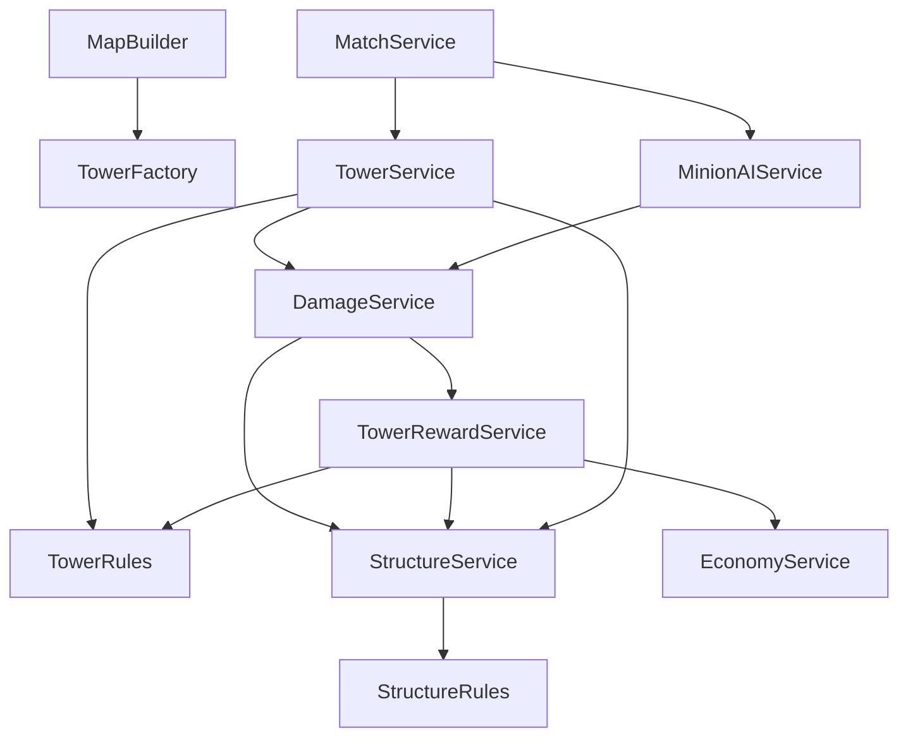

# Защитные башни — 28 октября 2026

## Состояние проекта и результат

Перед работой проверены актуальные исходники и незакоммиченные изменения Stage 5. OrangeNinja, процедурные анимации обоих типов суставов R15, Расенган, клоны, Ветряная ладонь, магазин и прогрессия уже существовали. Они сохранены; герой не реализовывался заново. Коммиты и публикация не выполнялись.

Добавлены шесть башен: по одной на Top/Mid/Bottom у Blue и Red. Они защищают базу, атакуют противников, дают командное золото и входят в маршруты миньонов. Вся игровая логика серверная; клиент отвечает за интерфейс и косметические эффекты.

**Проверки сборки, типов и чистой логики PASS. Studio, два клиента, физическое прохождение матча и визуальная проверка NOT RUN.** Два доступных инструмента Windows не запустились; причина и воспроизведение ниже. Скриншотов этой итерации нет.

## Конфигурация и размещение

`src/shared/Config/TowerConfig.luau`:

| Параметр | Значение |
| --- | --- |
| Health | 600 |
| Range | 28 studs, повторная проверка при контакте |
| Damage | 18 до защиты цели |
| AttackInterval | 1,2 с между началами атак, включает подготовку |
| Windup | 0,3 с |
| UpdateInterval | 0,1 с, один общий серверный цикл |
| AggroDuration | 3 с от последнего подтверждённого урона героя |
| TeamGold | 50 каждому допустимому игроку атакующей команды |
| TargetPriority | Minion=1, Hero=2, Summon=3 |
| AllowSummons | false; текущие неуязвимые клоны исключены из выбора |
| Visual | Импульс 0,16 с, разрушение 0,65 с, максимум 24 эффекта, дистанция 220 |

Позиции относительны `MapConfig.Origin=(0,32,0)`:

| Линия | Blue | Red |
| --- | --- | --- |
| Top | (-70, 4, -99) | (70, 4, -99) |
| Mid | (-70, 4, 15) | (70, 4, 15) |
| Bottom | (-70, 4, 99) | (70, 4, 99) |

Башни зеркальны по X. Центр основания отстоит от центральной линии маршрута на 15 studs. Единственный физический hurtbox — колонна HumanoidRootPart размером 5×6×5: её ближайший край находится за краем дороги шириной 24. Декоративные основание, цветные полосы, навершие, стойки и кристалл собраны из оригинальных Parts; они не сталкиваются и не участвуют в запросах попадания. Внешние ассеты, модели и скрипты не добавлялись.

Модель хранится в `Workspace.Map.Towers/<Team>_<Lane>`, имеет `ManagedTower`, `EntityKind="Tower"`, `TeamId`, `Lane`, `Humanoid` и `PrimaryPart`. Повторные Build/Start не создают модели и подписки повторно. Неизвестные объекты не удаляются: конфликт имени Map.Towers или зарезервированного имени башни вызывает понятную ошибку. Для своей карты настройте Positions относительно общего Origin; генератор не перестраивает существующие башни при повторном Build.

## Выбор цели и выстрел

Условия: InProgress, действующая команда, живая башня и живая вражеская цель в Workspace. Герой должен быть текущим Character подключённого игрока. Удалённые модели, старые Character и выбывшие игроки недопустимы. Клоны не регистрируются как герои и не отвлекают башни. Сам флаг AllowSummons не делает существующих клонов уязвимыми: для нового боевого вида призывов потребуется отдельная регистрация и политика DamageService.

Обычный выбор: ближайший допустимый миньон, затем герой. При равных расстояниях сохраняется текущая цель; иначе используется стабильный числовой ID модели в пределах её жизни на сервере. Цель фиксируется на время подготовки. Реестр перебирается в общем цикле, без отдельного task-loop для каждой башни.

`DamageService.Applied` сообщает только фактически снятые HP. Если атакующий и пострадавший — герои противоположных сторон, пострадавший находится в радиусе союзной башни, а атакующий доступен башне, включается агрессия на 3 с. Она отменяет подготовку по предыдущей цели и начинает полную подготовку по агрессору. Повторный подтверждённый урон продлевает срок. Выход из дальности/видимости, смерть или исчезновение агрессора снимает приоритет; возвращение само по себе его не восстанавливает. Урон клона приписан владельцу существующей системой, поэтому может вызвать агрессию к владельцу, если он находится в зоне; сам клон целью не становится.

Контакт проходит через `DamageService.Apply`. Дальность, жизнь, команда, фаза и видимость перепроверяются во время подготовки и непосредственно перед выстрелом. Луч идёт от боевого центра колонны: декоративная высота кристалла не позволяет стрелять поверх короткой стены. Тела бойцов исключены из луча, твёрдая геометрия карты — нет. Touched и клиентские сообщения не определяют урон. Летящий импульс показывает уже рассчитанный выстрел и не является физическим снарядом.

## Сооружения, база и награды

Общее правило `StructureRules.isStructure` определяет Base/Tower. `FighterStateService` не регистрирует их как бойцов; M1 и способности применяют к ним урон без stun/knockback. CombatLifeService не создаёт для них историю убийства: разрушение не даёт XP, K/D/A или счётчик миньонов.

| Источник | Башня | База |
| --- | --- | --- |
| M1 | Да | Только после всех трёх башен |
| Melee/Ranged миньоны | Да | Только после всех трёх башен |
| Расенган | Да | Только после всех трёх башен |
| Ветряная ладонь | Нет | Нет |
| Теневые клоны | Нет | Нет |
| Прямой серверный DamageService.Apply | Да, после общих проверок | Та же центральная защита |

`StructureService` хранит реестр сооружений и считает живые башни. `DamageService.CanDamage` централизованно проверяет `CanReceive`: пока у стороны осталось хотя бы одно живое сооружение вида Tower, урон базе равен нулю. Защита не зависит от UI, ForceField или частоты обновления HUD. После третьей башни база становится доступной сразу по серверному состоянию.

Разрушение однократное: TowerRules отменяет цель, агрессию и подготовленный выстрел. Башня получает IsDestroyed, перестаёт участвовать в выборе целей; все части отключают столкновения и запросы. Остаётся статичный серый постамент, остальные части скрываются. Это шесть ограниченных моделей, без бесконечного накопления обломков. Удаление модели отменяет её работу и снимает регистрацию без выплаты за уничтожение геометрии.

`TowerRewardService` синхронно вызывается из подтверждённого пути DamageService после положительного урона. При смертельном ударе по зарегистрированной башне чистое правило однократной выплаты выдаёт через EconomyService по 50 Gold всем подключённым активным невыбывшим игрокам атакующей команды, независимо от жизни и расстояния. Последний удар миньона также даёт командное золото. Выплата завершается до возможности добить базу следующим вызовом в том же кадре. Отдельный слабый реестр выплат не сбрасывается вместе с профилем игрока; повторно наградить старую башню через ResetProgression нельзя.

## Миньоны и матч

Существующий локальный выбор вражеских миньонов и героев сохранён и проверяется раньше сооружений. Далее миньон учитывает башню своей линии в DetectionRange и атакует в пределах обычного AttackRange/AttackCooldown с прежней проверкой видимости. Близкие сооружения других линий доступны в AttackRange.

Вне локального боя миньоны продолжают существующий маршрут. Башня рядом с маршрутом перехватывает продвижение; после её разрушения миньоны возвращаются к следующей точке. В конце маршрута приоритет цели движения — оставшаяся вражеская башня своей линии, затем ближайшая оставшаяся башня другой линии, затем открытая база. Это позволяет очищенной линии помогать другим вместо ожидания у неуязвимого ядра. Поиск пути остаётся существующим простым MoveTo с восстановлением застревания; сложные пользовательские лабиринты требуют отдельных маршрутов.

MatchService вызывает TowerService.Update каждые 0,1 с. При Finished немедленно вызывается CancelAll, а Update и DamageService дополнительно проверяют фазу. Выбывшие стороны прекращают стрелять. Новый матч запускается новым сервером: End Session → Play. ResetProgression не восстанавливает разрушенные башни и не перезапускает карту.

## Архитектура



StructureService не импортирует DamageService/TowerService; реестр защиты находится ниже исполнителей, поэтому циклических require нет. Агрессия подписана на Applied, визуальные события — на TowerService.Event. SurvivalState реплицирует TowersRemaining/TowersTotal/BaseProtected для каждой стороны; TowerEvent передаёт Shot/Destroyed, входящего игрового обработчика у него нет.

## Интерфейс

Над каждой башней — команда, линия, HP и полоса здоровья. Idle даёт постоянное свечение, Charging увеличивает кристалл и яркость, Attacking показывает импульс, Destroyed — вспышку и постамент. TowerState/ChargeEndsAt/LastShotAt задаёт сервер; клиент не меняет размер боевой колонны. TowerVFXController ограничивает эффекты по времени, дистанции и количеству, уничтожает завершённые экземпляры.

Матчевая панель показывает башни 3/3 → 0/3 и защиту каждой базы. Billboard базы пишет «Защищена башнями» или «База уязвима». Сообщение о падении башни живёт 4 с, новые сообщения заменяют предыдущее. На узком экране сокращается подпись базы и ширина панели, а не весь HUD до нечитаемого масштаба. В портретном режиме способности сдвинуты ниже панели башен и её сообщения, уведомление награды — ниже способностей. Магазин остаётся поверх HUD, его ввод блокирует атаки как прежде. Раскладка проверена по коду для ПК/портретного/альбомного режима; фактическая читаемость и Roblox safe areas **NOT RUN**.

## Свежие проверки

Инструменты: Rojo 7.7.1, Luau CLI 0.744, luau-lsp 1.70.1 с Roblox definitions и новым solver. Журнал этой итерации: [towers-static-2026-10-28.log](../tests/results/towers-static-2026-10-28.log).

| Проверка | Статус |
| --- | --- |
| Основная сборка и пять тестовых сцен, все sourcemap | PASS |
| Классы entrypoint, отделение геометрии/тестов от production | PASS |
| Компиляция 83 Luau-файлов | PASS |
| Типы чистых модулей, всей игры и пяти Studio-сцен | PASS |
| TowerRules/StructureRules | 49 PASS |
| AbilityState/HeroPoses | 55 PASS |
| CombatState, MatchState, Progression, Rewards, RequestLimiter | PASS, выполнены заново |
| Tower/Survival/Progression/Hero/M1 в Studio | NOT RUN |
| Два клиента, визуальные эффекты, маршруты, ПК и телефон | NOT RUN |

Команда:

```powershell
powershell.exe -NoProfile -ExecutionPolicy Bypass -File .\scripts\check.ps1 `
  -LuauDirectory "$env:TEMP\anime-fight-luau-0.744" `
  -LuauLspDirectory "$env:TEMP\anime-fight-luau-lsp-1.70.1"
```

Статическая проверка не выполняет Roblox-физику. Сцены подготовлены, собраны и типизированы; их наличие не считается успешным игровым прогоном. Старые журналы предыдущих итераций не использованы как доказательство. В Survival/Progression/Hero перед прежними проверками базы добавлено разрушение башен через Damage.Apply; исходные проверки величин урона и победы сохранены. Изолированный M1-сценарий не изменён.

Основной `node_repl/@oai/sky` и резервный `cua.getState()` завершились до управления Studio с одинаковым `windows sandbox failed: CreateProcessWithLogonW failed: 2`. [Свежий журнал недоступного прогона](../tests/results/towers-studio-2026-10-28-not-run.log). Скриншоты получить не удалось.

## Воспроизведение Studio-тестов

1. Остановить старую сессию, собрать свежие файлы командой выше. Открывать File → Open from File; не подключать production Rojo к тестовой сцене.
2. Открыть `build/tower-tests.rbxlx`, Server & Clients → **2** → Play/F7. Не управлять персонажами во время сценария. В Output сервера ждать `[TowerTests] ALL PASS`; FAILED, ошибка любого клиента или отсутствие итоговой строки означает непройденный тест.
3. Новый сценарий проверяет шесть моделей и повторные Start/Build; команды; новые стены и выход из радиуса во время подготовки; агрессию; отмену Finished/удаления цели/разрушения; реальный M1 и Расенган; запрет других навыков по сооружениям; центральную защиту базы от прямого урона, M1, способностей и обоих видов NPC; приоритет локального боя, атаку башни и физическое продолжение маршрута; однократные 50 Gold, награду мёртвому союзнику, отсутствие K/D/A/миньонного счётчика; открытие базы и победу; репликацию HUD/Shot двум клиентам и безопасность декораций/эффектов.
4. Отдельно выполнить `combat-regression-stage3.rbxlx`, `survival-tests.rbxlx`, `hero-tests.rbxlx` с **2** клиентами и `progression-tests.rbxlx` с **3**. Ожидать соответствующие `[M1Tests]`, `[SurvivalTests]`, `[HeroTests]`, `[ProgressionTests] ALL PASS`.
5. В основной сборке вручную пройти линию с волной, увидеть все состояния башни с двух клиентов, разрушить три башни и базу. Проверить стену до/после зарядки, смерть/выход героя при подготовке, уход за радиус, трёхсекундный возврат агрессии, отсутствие удара после завершения матча. На второй стороне проверить союзный запрет.
6. Device Emulator: 1920×1080, 390×844, 844×390 и 320×568. Проверить счётчики обеих сторон, сообщения, HP/XP/Gold, Z/X/C, магазин и мобильное управление без перекрытий. Снять новые скриншоты: шесть башен на карте, зарядка, выстрел, постамент, защищённая/открытая база, HUD на ПК и телефоне. Для маршрута и зарядки полезна запись, а не одиночный кадр.

Остаются непроверенными физический игровой цикл, баланс длительного матча, производительность большого сервера и визуальная читаемость. Реализация готова к указанному прогону; считать критерий игрового прохождения подтверждённым до него нельзя.
